# Gravity

The portfolio of Mohammad AlOulabi, a tech manager in Riyadh, told as one scroll show about gravity.

[](https://oulabi.dev)
[](https://github.com/MohOulabi/oulabi.dev/actions/workflows/ci.yml)
[](LICENSE)

[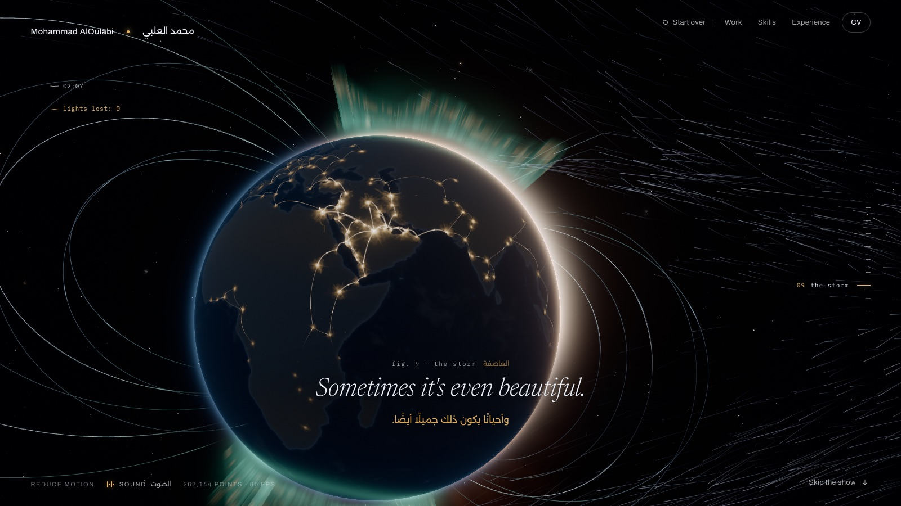](https://oulabi.dev)

**You bring the point. I bring the gravity.** The light you make on the first screen is your idea. Every figure shows
something gravity does to it, until the whole system is one star among his projects and your point settles into the
real sky over Riyadh tonight. Gravity is Mohammad: he never appears on screen, only what he holds together.

- **One scene, twelve figures.** A single WebGL canvas, scrubbed by the page's own scroll. No snapping, nothing
  scrolls by itself, and scrolling back unwinds it.
- **One gesture to begin, the rest optional.** The page waits on the first screen for your hold or click. After that a
  small ring offers one gesture at a time, and untouched, each figure plays out as you scroll.
- **Your point is the thread.** The light you let go stays marked from spark to sky. On a return visit it is still
  among the stars, and "Keep your sky" saves that sky as a PNG.
- **A GPU particle simulation.** Up to 262,144 motes in one points draw. They start as the sky over Riyadh at the moment
  the page loads: the 9,096 stars of the Yale Bright Star Catalogue in their real places, the Milky Way along the
  galactic plane, faint stars, a little dust and lights on the horizon.
- **An ink journal over the 3D.** Fine ink draws itself like an astronomer's notebook: circles, dashed orbits, leader
  lines and small notes, pinned to objects in the scene and moving with them. Its notes follow the show as it plays:
  your point's speed through each flyby, the cities as they light.
- **A live score.** Written out in D major and synthesized with the Web Audio API, with no audio files. Your first
  gesture starts it, and a switch turns it off.
- **Readable anywhere.** With reduced motion, without JavaScript or on a GPU that cannot run the show, the journal is
  printed as still plates. Every line of the show is in English with the Arabic beneath, and `/llms.txt` serves the
  profile as markdown.

## The show

<table>
  <tr>
    <td width="50%" valign="top">
      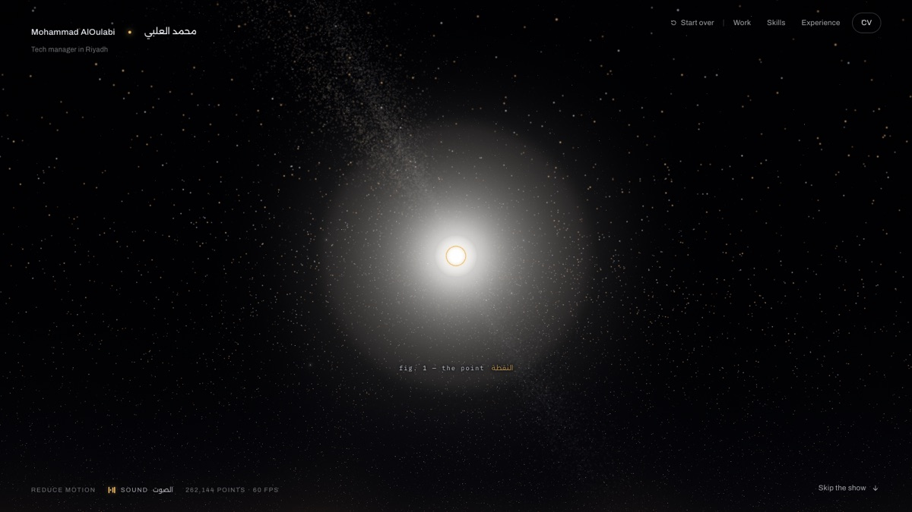
      <br>
      <b>Fig. 1, The point.</b> Dust drifts around the cursor. Hold to pull it into one blinding point, and let go for
      the big bang.
    </td>
    <td width="50%" valign="top">
      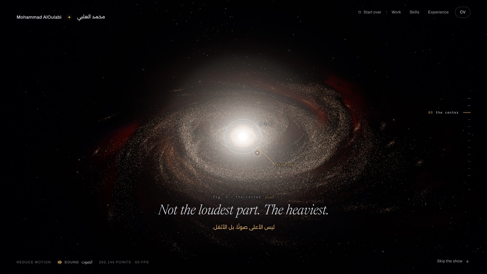
      <br>
      <b>Fig. 3, The center.</b> Three bright knots glow in the nebula. Click the one you think is heaviest: the others
      fall into it and a sun ignites there.
    </td>
  </tr>
  <tr>
    <td width="50%" valign="top">
      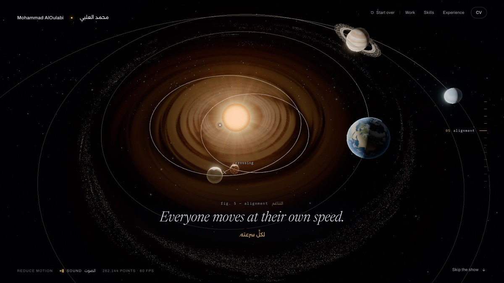
      <br>
      <b>Fig. 5, Alignment.</b> Two orbits cross and the planets head for a near miss. Hold to deepen the center's
      pull.
    </td>
    <td width="50%" valign="top">
      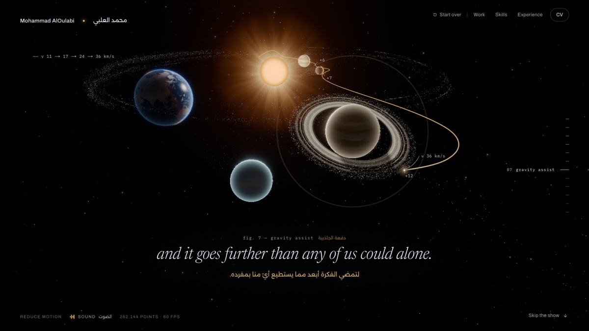
      <br>
      <b>Fig. 7, Gravity assist.</b> Your point slingshots around each planet, faster at every pass, toward the world.
      The ink writes its speed at each pass.
    </td>
  </tr>
  <tr>
    <td width="50%" valign="top">
      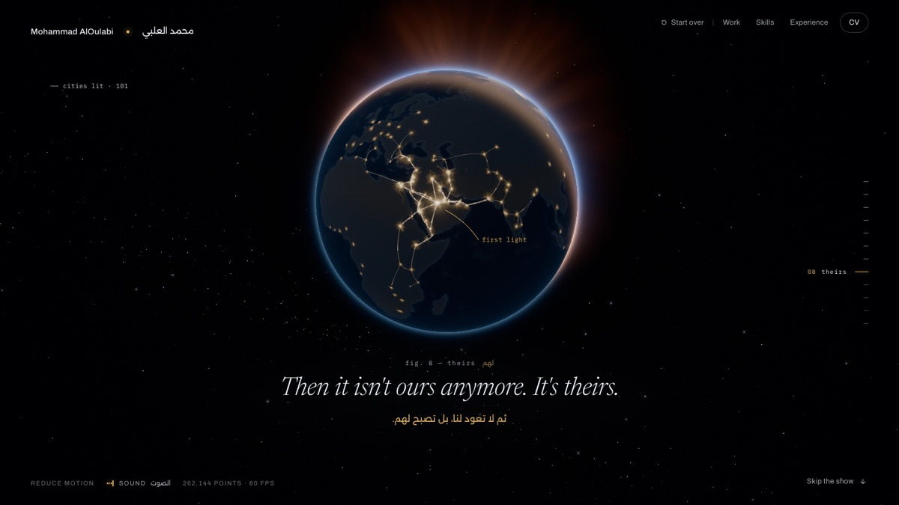
      <br>
      <b>Fig. 8, Theirs.</b> It falls onto the world's night side and splits into city lights that spread and wire
      together.
    </td>
    <td width="50%" valign="top">
      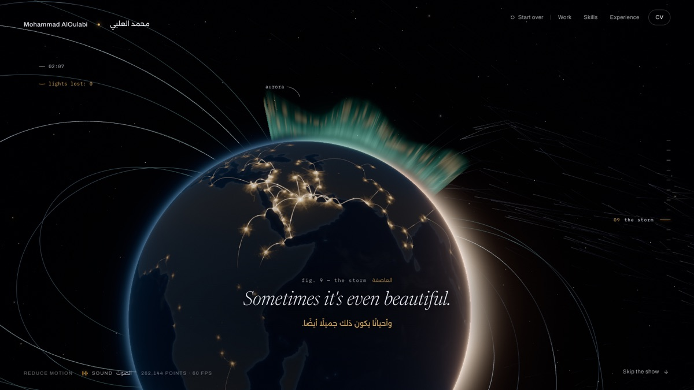
      <br>
      <b>Fig. 9, The storm.</b> A storm from deep space bends round the world's field and pours into the poles as
      aurora. Hold to push back. No light is lost.
    </td>
  </tr>
  <tr>
    <td width="50%" valign="top">
      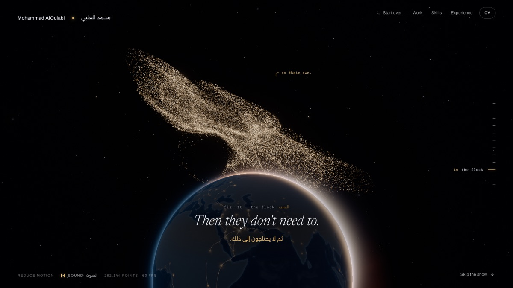
      <br>
      <b>Fig. 10, The flock.</b> The lights lift into a murmuration that follows the cursor, then flies on in step
      without it.
    </td>
    <td width="50%" valign="top">
      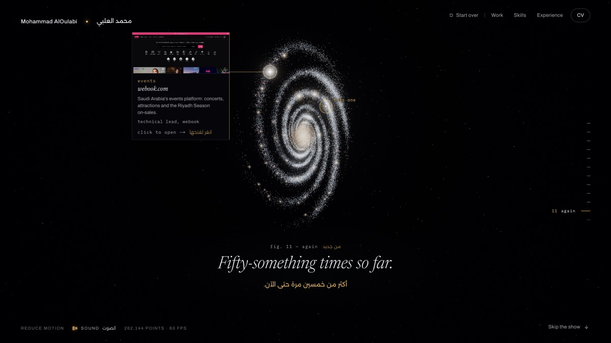
      <br>
      <b>Fig. 11, Again.</b> The whole system is one star now, and fifty-odd others light up: the projects and
      platforms. Hover one to read it, click it to open it in Work.
    </td>
  </tr>
  <tr>
    <td width="50%" valign="top">
      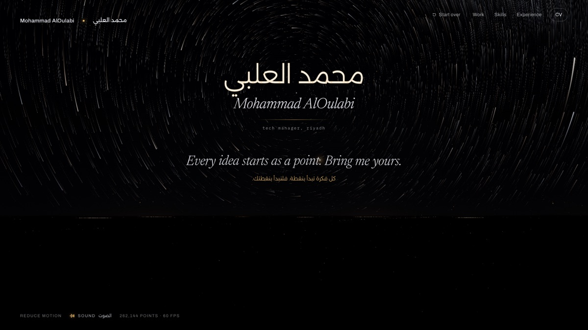
      <br>
      <b>Fig. 12, The sky.</b> The real sky over Riyadh tonight, with your point among the stars. The journal is
      signed.
    </td>
    <td width="50%" valign="top">
      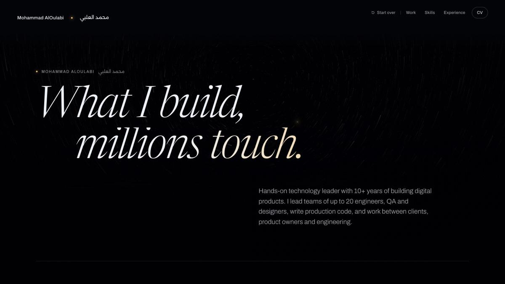
      <br>
      <b>The record.</b> After the show, a calm page in normal flow: the work, the skills, the experience, contact and
      the full CV.
    </td>
  </tr>
</table>

Figures 2, 4 and 6 (a hundred versions, gathering and the window) play between these frames. Every figure, with its
gestures, lines and ink, is in [docs/STORY.md](docs/STORY.md).

## On a phone

<p align="center">
  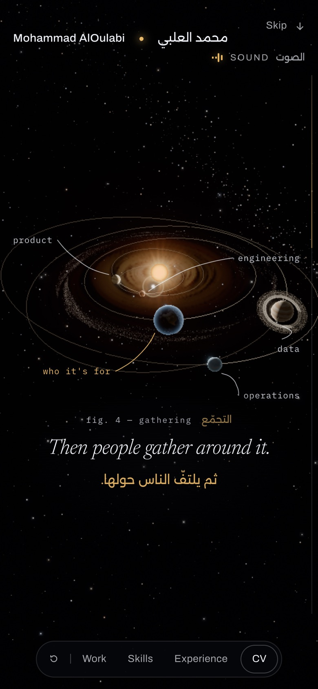
</p>

- **Tap to begin.** On a touch screen a tap gives the whole bang and starts the music.
- **Drag sideways** to turn the system, the world and the sky, or to lead the flock. An upright drag scrolls the story
  on.
- **Tap a star** once to name it, and again to open it in Work.
- **Sized for the phone.** Touch screens top out at the medium tier and a pixel ratio of 1.25. If iOS drops the WebGL
  context, the show is built again when it comes back.

## How it works

- **One clock.** `src/lib/clock.ts` runs everything from GSAP's ticker, in one order, every frame: Lenis's smooth
  scroll, story time, the DOM bridges and the score, then the render, by calling React Three Fiber's `advance` on a
  canvas set to `frameloop="never"`.
- **Story time.** `src/lib/story.ts` reads the natural scroll position as a figure position `T` (figure *i* spans
  `[i, i + 1)`) and follows it with a critically damped `Ts` that, inside the show, never moves faster than about a
  figure and a half a second. Everything animated reads `Ts`. The story only reads the scroll; it never moves it.
- **One contract.** `src/lib/journey.ts` holds each figure's length, its inner beats, its gesture windows and the
  hand-offs between modules (your point touches the world's night side at exactly `T = 7`). The GL, the DOM and the
  ink read their windows from there, never from literals.
- **Figures as functions.** `src/gl/show/engine.ts` orchestrates the core show. Each figure's controller
  (`figures/`), shaders (`glsl/`) and camera (`poses/`) are functions of story time and your choices, which is why
  scrolling back unwinds them. The Earth, its city lights and the storm are `src/gl/world/`.
- **The particles.** `src/gl/show/sim.ts` steps position and velocity textures on three.js's
  `GPUComputationRenderer`: 512 × 512 motes on the high tier, 256 × 256 on medium, 128 × 128 on low. The vertex
  order is bit-reversed, so any prefix of it is an even spread of the motes and the watchdog can halve them without a
  pop.
- **The ink.** The marks are data in `src/content/ink.ts`. The GL writes the 3D points they follow
  (`src/lib/anchors.ts`), `src/gl/project.ts` projects them once the frame is drawn, and `src/bridges/ink.ts` draws
  them in an SVG in that same frame, so a circle never slides off its knot. Strokes are scrubbed: scrolling back
  undraws them.
- **The gate.** `src/lib/gate.ts` keeps the page on the first screen until your own hold or click, which also starts
  the score. Skip the show, a link or a deep link always go through.
- **Content.** Every fact on the page comes from `src/content/site.ts`, built from the CV.

Frame loops never touch React state and are written to avoid allocating per frame.

<details>
<summary><b>Quality tiers and fallbacks</b></summary>
<br>

`src/lib/tier.ts` picks a tier once, at load:

- **static** without WebGL 2 (or with a major performance caveat), on a software renderer, or on the weakest GPUs.
- **low** when the browser asks to save data.
- Otherwise by the benchmark tier of [@pmndrs/detect-gpu](https://github.com/pmndrs/detect-gpu), read from
  `/benchmarks` with a 1.2 s timeout: high, medium or low on a desktop, medium or low on a touch screen. Safari names
  every Apple GPU the same way, so an Apple desktop with eight or more cores is trusted with high.

`?q=high`, `?q=medium`, `?q=low` or `?q=static` forces one. While it runs:

- **The pixel ratio is capped** at 2, 1.5 and 1.25 by tier, and at 1.25 on touch screens.
- **A watchdog** steps down after about two seconds of long frames (above 21.5 ms on average): first a lower pixel
  ratio, then half the motes, then a pixel ratio of 1 and a quarter of the motes, with a lighter nebula at each step.
  It only ever steps down.
- **Every shader program is compiled before the reveal**, so no figure hitches on its first frame.
- **Without `EXT_color_buffer_float`** the simulation runs in half floats.
- **A lost WebGL context** (iOS under memory pressure, a tab in the background) rebuilds the engine when it comes
  back.

</details>

<details>
<summary><b>Project structure</b></summary>
<br>

```text
src/
  app/            routes: the page, the 404, /llms.txt, /llms-full.txt, robots, sitemap, manifest, icons; globals.css
  components/     the page: chrome, cursor, experience (boots it all), full-cv (+ full-cv.css), ink, spine, stills
    sections/     show (a section per figure), record, ending
    ui/           cv-button, gap, motion-toggle, sound-toggle, star-card, riyadh-time
  bridges/        imperative DOM <-> GL bridges, no React state: boot, cut, ink, ink-geom, record, show-dom, spine,
                  star-card
  gl/             stage.tsx (the canvas), precompile, project (the ink's projector), shared (GL <-> DOM state)
    post/         effects.tsx: bloom, tone mapping, a vignette and dither finish, and the sky's long exposure
    show/         the core show: engine, camera, the GPU sim (sim, sim-shaders, point-shaders), figures/, glsl/, poses/
    world/        the Earth, its city lights and the storm
  lib/            clock, story, stations, journey (the timeline contract), anchors, gate, hold, scroll, restart, show,
                  tier, and small helpers
  content/        site.ts (every fact on the page), ink.ts (the journal), seo.ts, llms.ts, cv-text.ts
  audio/          the synthesized score, its instruments and its QA meter
scripts/          shots.mjs (visual QA); bake-bsc5.mjs, bake-earth.mjs, bake-stills.mjs (asset bakes)
data-src/         the Yale Bright Star Catalogue, input of bake:stars
public/           served as is: data/, benchmarks/, stills/, work/, cv/, me.webp, og.jpg, icons
docs/             STORY.md (the creative spec) and images/ (the frames on this page)
```

</details>

## Stack

- **Framework.** [Next.js](https://nextjs.org) 16.4 (App Router, static export, Turbopack), React 19.3, TypeScript 6.
- **3D.** [three.js](https://threejs.org) r187 on WebGL 2 with custom GLSL,
  [React Three Fiber](https://r3f.docs.pmnd.rs) 9.8, [postprocessing](https://github.com/pmndrs/postprocessing) 6.39
  for bloom and tone mapping.
- **Motion.** [GSAP](https://gsap.com) 3.15, whose ticker drives the frame, and
  [Lenis](https://lenis.darkroom.engineering) 1.3 for smooth scroll.
- **Sound.** The Web Audio API.
- **Quality tier.** [@pmndrs/detect-gpu](https://github.com/pmndrs/detect-gpu) 6.0.
- **Measurement.** Vercel Web Analytics and Speed Insights.
- **Tooling.** [bun](https://bun.sh) 1.4 for packages and scripts, [Biome](https://biomejs.dev) 2.6 for linting and
  formatting, [Playwright](https://playwright.dev) 1.65 for the screenshot scripts.

## Getting started

You need [bun](https://bun.sh) 1.4.4 and [Node.js](https://nodejs.org) 22.18 or newer: `bun run` starts Next.js and
the other tools on Node, and the scripts in `scripts/` run on Node.

```bash
git clone https://github.com/MohOulabi/oulabi.dev.git
cd oulabi.dev
bun install
bun run dev      # http://localhost:3000
bun run build    # static export to out/
bun run start    # serves out/
```

It is `bun run build`, never `bun build` (that is Bun's own bundler). `bun run dev -p 4317` picks another port. Add
`?q=high`, `?q=medium`, `?q=low` or `?q=static` to the address to force a quality tier.

<details>
<summary><b>Every script</b></summary>
<br>

| Command | What it does |
| --- | --- |
| `bun run dev` | Next.js dev server with Turbopack |
| `bun run build` | Static export to `out/` |
| `bun run start` | Serves `out/` with `serve` |
| `bun run typecheck` | `tsc --noEmit` |
| `bun run lint` | Biome: lint, format and import order (`biome check`) |
| `bun run lint:fix` | Biome: apply the safe fixes and the formatting |
| `bun run format` | Biome: format every file |
| `bun run shots` | Screenshots of the running site at chosen story times |
| `bun run bake:stars` | Builds the star data from the Yale Bright Star Catalogue |
| `bun run bake:earth` | Bakes the Earth's map and the cities' distance to the sea |
| `bun run bake:stills` | Shoots the printed layout's stills of the Earth from the live show |

</details>

Biome formats at 100 columns with 2 spaces, double quotes, trailing commas and semicolons, and file names are
kebab-case. The repository's `.vscode` settings make Biome the formatter in VS Code. CI runs the lint, the typecheck
and the build on every push and pull request to `main`.

<details>
<summary><b>Visual QA</b></summary>
<br>

`scripts/shots.mjs` drives the installed Google Chrome on macOS through Playwright (no browser download; it asks for
the Metal backend) and saves a screenshot at each story time.

```bash
bun run build
bun run start -l 4317
bun run shots --url "http://localhost:4317/?qa" --t 0,1,2,3,4,12,13,14 --size 1440x900 --out shots
```

Story time `T` counts figures from 0; past 11 it reads on into the ending and the record. Other options: `--q` (the
tier, `high` by default), `--dpr`, `--settle` (ms to wait at each time) and `--reduce 1` (reduced motion). The QA
hooks are on in dev builds, or in a production build opened with `?qa`: `window.__story.jump(T)` sets story time,
`window.__story.stats()` returns the tier, the motes drawn, the watchdog's level, the frame time and the draw calls,
and `window.__sound` measures the score. `?wd=0` turns the watchdog off.

</details>

<details>
<summary><b>Asset bakes</b></summary>
<br>

The baked files are committed, so you only need these to change them.

- **`bun run bake:stars`** reads `data-src/bsc5.dat` and writes `public/data/bsc5.json`: every star with
  coordinates, brightest first. Run it from the repository root.
- **`bun run bake:earth`** rasterizes Natural Earth's 1:50m land (from `world-atlas`, decoded with
  `topojson-client`) into `public/data/earth.png`, a signed distance to the coast plus where people live, and writes
  how far each city in `src/gl/world/places.ts` stands from the sea into `src/gl/world/inland.ts`. It imports that
  TypeScript file directly, hence Node 22.18 or newer. It fails if a city is not on land.
- **`bun run bake:stills --url http://localhost:4317`** shoots the printed layout's plates of the Earth (figs. 8 and
  9) from the running site into `public/stills/`. Like `shots`, it needs macOS and Google Chrome; on a production
  build, add `?qa` to the URL.

</details>

## Deploying

`bun run build` writes a static export to `out/` (`output: "export"` in `next.config.ts`), so any static host can
serve it. The site runs on Vercel, configured in `vercel.json`: it sends www.oulabi.dev and his other addresses to
oulabi.dev, serves `/llms.txt` and `/llms-full.txt` as markdown and keeps the RSC payload files out of search.
`NEXT_PUBLIC_SITE_URL` sets the site's address (see `.env.example`). The Vercel Web Analytics and Speed Insights
components load their scripts from paths only Vercel serves, so remove them from `src/app/layout.tsx` if you host it
elsewhere.

## Credits

- **Stars.** The Yale Bright Star Catalogue, 5th Revised Edition (Hoffleit and Warren, 1991), NASA ADC / CDS
  catalogue V/50. Public domain.
- **The Earth.** Made with [Natural Earth](https://www.naturalearthdata.com/) 1:50m land (public domain), through
  [world-atlas](https://github.com/topojson/world-atlas) by Michael Bostock and
  [topojson-client](https://github.com/topojson/topojson-client) (both ISC).
- **GPU benchmarks.** The data of [@pmndrs/detect-gpu](https://github.com/pmndrs/detect-gpu) by Tim van Scherpenzeel
  (MIT), from GFXBench.
- **Simplex noise.** [webgl-noise](https://github.com/stegu/webgl-noise) by Ashima Arts and Stefan Gustavson (MIT).
- **Fonts.** Archivo, Newsreader, IBM Plex Mono and Alexandria from Google Fonts through `next/font` (SIL Open Font
  License 1.1).
- **Libraries.** [GSAP](https://gsap.com) by GreenSock, under its [standard license](https://gsap.com/standard-license);
  [three.js](https://threejs.org), [React Three Fiber](https://github.com/pmndrs/react-three-fiber),
  [postprocessing](https://github.com/pmndrs/postprocessing) and [Lenis](https://github.com/darkroomengineering/lenis).
- **Made with coding agents.** Mohammad directed it and built it with
  [Claude Code](https://claude.com/claude-code), as the colophon at the end of the show says.

## License

The code is under the [MIT license](LICENSE). The personal content is not: the copy, the CV, the ink journal, the
creative spec, the portrait, the social card, the icons and the frames of the show (`public/stills/` and the
screenshots in `docs/images/`) are Mohammad AlOulabi's, all rights reserved, as are his name and likeness. The
screenshots in `public/work/` belong to the sites they show. [NOTICE.md](NOTICE.md) has the details.

**If you fork it,** the code is yours to learn from and reuse. Replace the content with your own before you publish
anything:

- `src/content/`: the copy, the CV text, the ink journal and the text of `/llms.txt`
- `docs/STORY.md` and `docs/images/`
- `public/cv/`, `public/work/`, `public/og.jpg` and `public/me.webp`
- `public/stills/` (bake your own with `bun run bake:stills`)
- the icons: `public/icon-*.png`, `src/app/icon.svg`, `src/app/favicon.ico` and `src/app/apple-icon.png`

Then remove the redirects in `vercel.json`, which send www.oulabi.dev and his other addresses to oulabi.dev, and set
`NEXT_PUBLIC_SITE_URL` to your own address.

To report a security issue, see [SECURITY.md](SECURITY.md).
